# ConsultaEC

**ConsultaEC** reúne en una interfaz académica tres consultas: contribuyentes, vehículos y puntos de licencia. La aplicación coordina servicios Java independientes y muestra la procedencia, fecha y estado de cada respuesta para evitar interpretaciones engañosas.

Las consultas de existencia de RUC, datos del contribuyente y vehículo por placa están implementadas como integraciones HTTP con el **SRI**; sus pruebas automatizadas usan un servidor local simulado y todavía no acreditan una respuesta oficial en vivo. Los **puntos ANT son sintéticos**: el docente autorizó la simulación después de un fallo HTTP 502 del portal de citaciones. En una comprobación posterior, el mismo portal respondió HTTP 401. Ninguno de los puntos mostrados constituye un registro oficial.

**Tecnologías:** React 19, TypeScript y Vite; Java 17 y Spring Boot; Redis local en Docker; Maven Wrapper y pruebas de Node.js/JUnit.

## Vista previa

Las capturas de esta página están **pendientes de ser tomadas por los estudiantes**. Los enlaces de imagen se mostrarán en GitHub cuando se añadan archivos auténticos con estos nombres; no se incluyen imágenes ficticias.

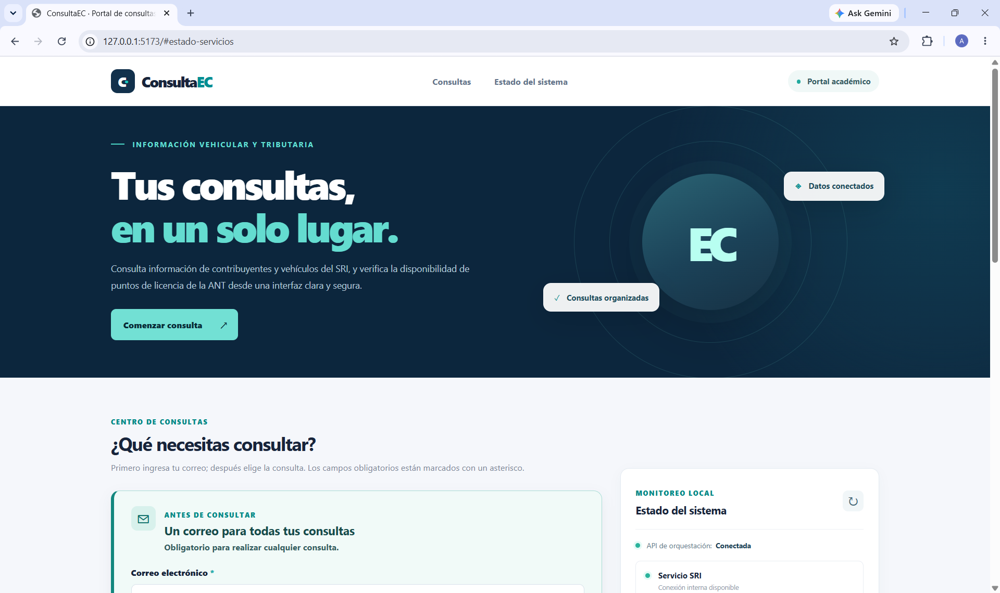


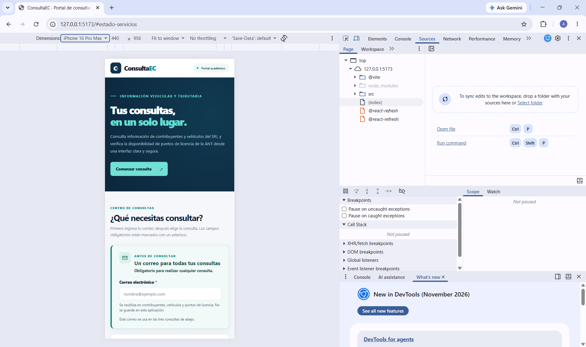


## Funciones principales

- Un correo obligatorio y compartido para las tres consultas, con validación en línea y foco en el campo que debe corregirse.
- Consulta de contribuyente y, tras confirmar una persona natural, consulta de vehículo por placa.
- Consulta independiente de puntos ANT simulados, con recuperación del último dato válido si falla el proveedor.
- Resultados con fuente y fecha; avisos visibles para simulaciones, caché y errores técnicos.
- Interfaz adaptable, navegación por teclado y estados de carga que impiden envíos duplicados.

## Arquitectura del sistema

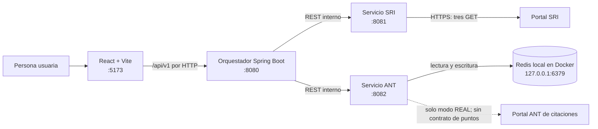

| Componente | Responsabilidad |
|---|---|
| `frontend/` | Formularios, validación de formato, accesibilidad y presentación. Solo llama al orquestador. |
| `orquestador/` | API pública, validación y coordinación con los dos servicios internos. |
| `servicio-sri/` | Solicitudes SRI de existencia de RUC, detalles y vehículo por placa; normaliza las respuestas. |
| `servicio-ant/` | Proveedor simulado o adaptador del portal, validación de puntos y caché Redis. |

Las cuatro aplicaciones se inician por separado. El `pom.xml` raíz solo facilita las pruebas y la compilación de los tres proyectos Java. Redis pertenece exclusivamente al servicio ANT. Hay más detalle en [arquitectura](docs/arquitectura/README.md).

## Arquitectura C4 en IcePanel

La vista **C1** sitúa a la persona usuaria, ConsultaEC, el SRI y el portal ANT. La **C2** muestra React, orquestador, ambos microservicios y Redis local con sus conexiones. La **C3** de ANT distingue controlador, caso de uso, proveedor simulado o portal y adaptador Redis. La guía de [actualización del modelo](docs/arquitectura/ACTUALIZACION_ICEPANEL.md) describe las correcciones pendientes para representar Redis local y la simulación.

**Enlace al modelo IcePanel de ConsultaEC:** https://s.icepanel.io/F36EhoPAOn7V1K/GoRP

La captura de la arquitectura propia se guardará en `docs/evidencias/11-arquitectura-c4.png`. El modelo en línea todavía debe revisarse por quien tenga acceso de edición.

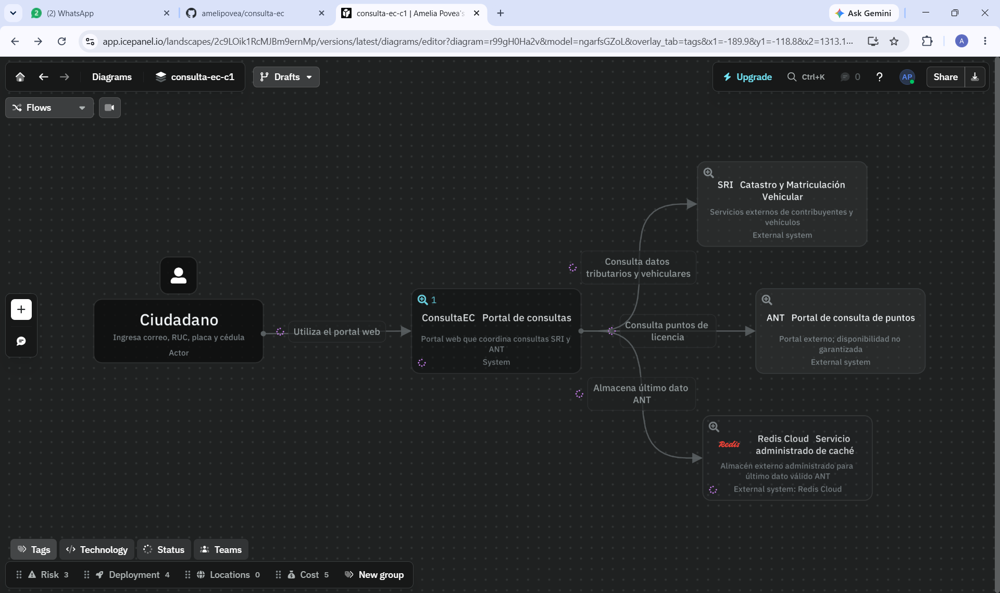


## Consultas y contratos HTTP

El navegador envía `POST` con JSON únicamente a `127.0.0.1:8080`:

| Consulta | Ruta pública | Campos |
|---|---|---|
| Contribuyente | `/api/v1/contribuyentes/consultas` | `correo`, `ruc` de 13 dígitos |
| Vehículo | `/api/v1/vehiculos/consultas` | `correo`, `ruc`, `placa`; requiere confirmar persona natural |
| Puntos de licencia | `/api/v1/licencias/puntos/consultas` | `correo`, `cedula` de 10 dígitos |

Una respuesta correcta contiene `tipoConsulta`, `estado=OK`, `fuente`, `datos` y `metadatos.consultadoEn` / `metadatos.desdeCache`. Los errores usan `error.codigo`, `mensaje`, `solicitudId`, `instante` y `detalles`. La validación de formato puede responder HTTP 400; ausencia de datos, 404; contribuyente que no es persona natural, 422; errores de contrato o proveedor, 502; y dependencia indisponible, 503. Consulte los [contratos públicos](docs/contratos/FASE_2_API_REST.md), [SRI](docs/contratos/FASE_3_SRI.md) y [ANT](docs/contratos/FASE_4_ANT.md).

El servicio SRI llama por GET al catastro para comprobar existencia del RUC y recuperar sus detalles; solo después de confirmar persona natural consulta el servicio de matriculación por placa. El correo no se transmite a los servicios internos. La interfaz no guarda identificadores en `localStorage`, `sessionStorage` ni parámetros de URL.

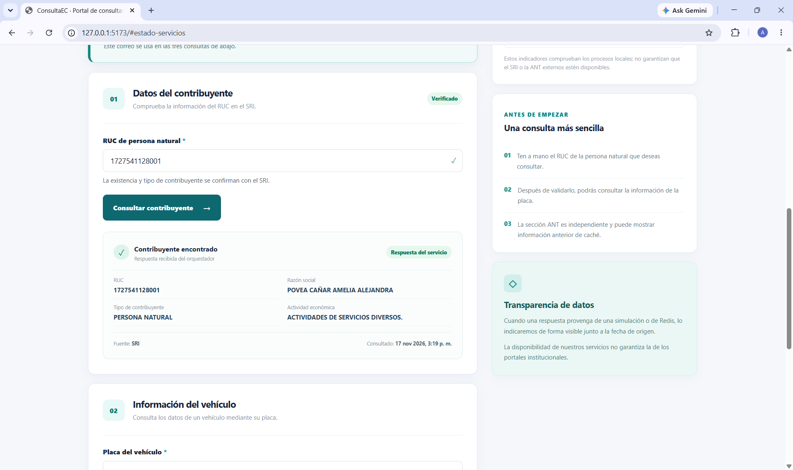


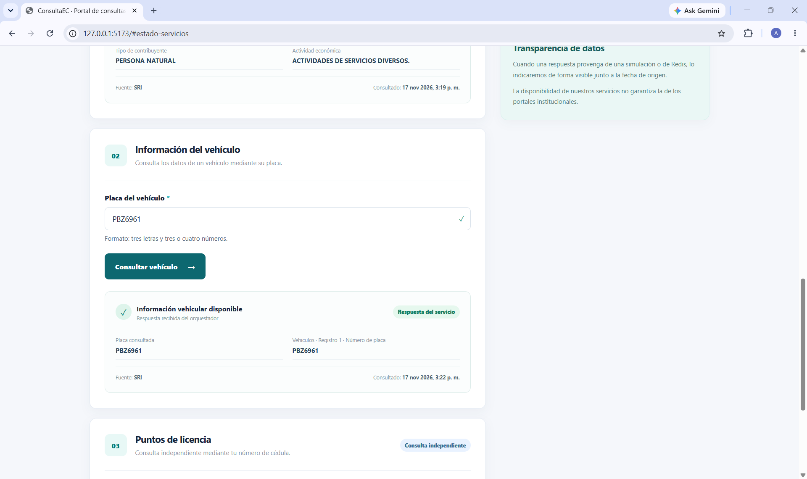


## ANT simulado y recuperación ante fallos

En `ANT_MODO=SIMULADO`, una consulta nueva devuelve puntos sintéticos con `fuente=SIMULACION_ANT`, `desdeCache=false` y la fecha de origen. Solo se guarda un dato válido. Redis local conserva el último dato durante **86400 segundos** de forma predeterminada, bajo una clave HMAC que no contiene la cédula legible.

Si el proveedor falla y existe caché vigente, ANT devuelve `SIMULACION_ANT_CACHE`, `desdeCache=true`, los puntos anteriores y **`consultadoEn` original**. La interfaz advierte que la información puede estar desactualizada. Tras vencer el TTL, la caché deja de responder. Si no hay dato previo, la API entrega un error 503 estructurado, sin presentar cero puntos ficticios. El modo `REAL` consulta una página JSP de citaciones, pero no deduce puntos de ella porque no hay un contrato de puntos verificado.

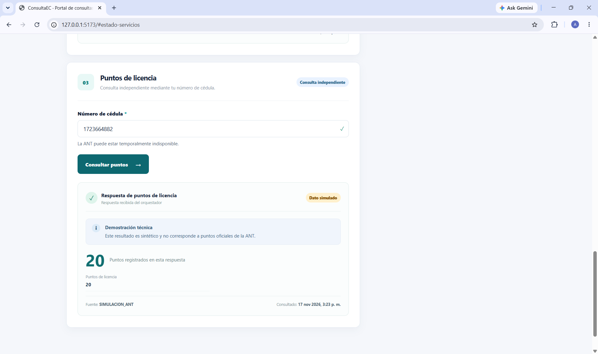


## Evaluación de usabilidad y mejoras de experiencia de usuario

**Objetivo:** comprobar si las personas pueden realizar las consultas, reconocer los datos obligatorios e interpretar los resultados. Una persona que probó la interfaz comunicó: «Le cambiaría que sea más obvio que el mail es necesario para realizar cualquier consulta.» Añadió: «Porque me pasó a mí al probarlo.» Es un hallazgo cualitativo de **prevención de errores**; no se registraron duraciones ni tasas de finalización.

| Hallazgo | Propuesta de mejora | Cambio implementado | Evidencia |
|---|---|---|---|
| El correo obligatorio no destacaba antes de las tres consultas. | Presentar un campo compartido con una instrucción visible. | Sección «Un correo para todas tus consultas», frase «Obligatorio para realizar cualquier consulta.» y ayuda que nombra las tres operaciones. | Diferencia con `ada34d3` y prueba de renderizado. |
| Una persona podía intentar enviar sin advertir el correo. | Mostrar un error próximo al campo y guiar a la corrección. | Validación prioritaria, foco en correo, mensaje en línea asociado con ARIA y rechazo previo a cualquier petición HTTP inválida. | Pruebas de flujo, API y accesibilidad del renderizado. |

La revisión técnica añadió un bloqueo inmediato de envíos repetidos, estados de carga anunciados, ayudas y errores más legibles y botones móviles de ancho completo. Se conservaron los avisos de simulación y caché con la fecha original. La compilación y 22 pruebas del frontend verifican estos comportamientos; se revisó el renderizado local en escritorio y en un ancho CSS cercano al móvil. **Todavía falta repetir la evaluación con personas** para medir si la mejora reduce errores. El método, la comparación antes/después y el protocolo de retest están en [USABILIDAD.md](docs/pruebas/USABILIDAD.md).

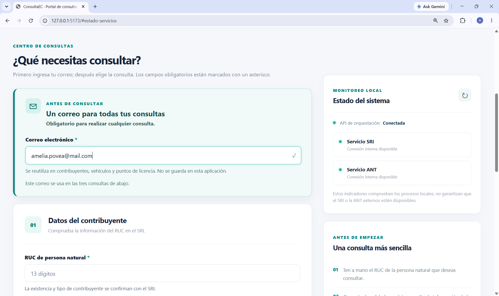


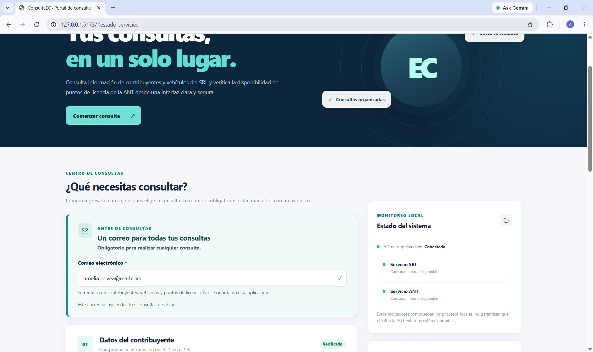


## Instalación y arranque manual

Se necesitan Windows con PowerShell, Java 17, Node.js/npm, Docker Desktop y el contenedor local `consultaec-redis`. Maven Wrapper y npm pueden descargar dependencias en el primer uso. El secreto HMAC estable de ANT se encuentra cifrado con DPAPI para el usuario de Windows en `%APPDATA%\ConsultaEC\ant-hmac.dpapi`; debe tener al menos 24 caracteres. No se versiona ni se imprime.

Desde la raíz del repositorio, iniciar y comprobar Redis:

```powershell
docker start consultaec-redis
docker exec consultaec-redis redis-cli ping
```

El segundo comando debe devolver `PONG`. Docker local usa `127.0.0.1:6379`, usuario `default`, contraseña vacía y TLS desactivado; `REDIS_SSL_ENABLED=true` sigue disponible para otros entornos. `servicio-ant/.env.example` enumera las variables, pero Java no lo carga automáticamente.

Abrir **cuatro terminales**:

**1. Servicio SRI, puerto 8081**

```powershell
cd C:\AME\JAVA\consulta-ec
.\mvnw.cmd -f servicio-sri\pom.xml spring-boot:run
```

**2. Servicio ANT, puerto 8082**

```powershell
cd C:\AME\JAVA\consulta-ec
$rutaHmac = Join-Path $env:APPDATA 'ConsultaEC\ant-hmac.dpapi'
$seguro = (Get-Content -LiteralPath $rutaHmac -Raw).Trim() | ConvertTo-SecureString
$env:REDIS_CACHE_HMAC_SECRET = (New-Object System.Net.NetworkCredential('', $seguro)).Password
if ($env:REDIS_CACHE_HMAC_SECRET.Length -lt 24) { throw 'Secreto HMAC insuficiente' }
$env:REDIS_ENABLED = 'true'
$env:REDIS_HOST = '127.0.0.1'
$env:REDIS_PORT = '6379'
$env:REDIS_SSL_ENABLED = 'false'
$env:REDIS_USERNAME = 'default'
$env:REDIS_PASSWORD = ''
$env:REDIS_TTL_SECONDS = '86400'
$env:ANT_MODO = 'SIMULADO'
$env:ANT_SIMULACION_FALLA = 'false'
.\mvnw.cmd -f servicio-ant\pom.xml spring-boot:run
```

Para probar el fallback, detener **solo ANT** con Ctrl+C, fijar `$env:ANT_SIMULACION_FALLA = 'true'` en la misma terminal y repetir el comando de ANT. Mantener Redis y el secreto sin cambios. Al terminar, restaurar `false`.

**3. Orquestador, puerto 8080**

```powershell
cd C:\AME\JAVA\consulta-ec
.\mvnw.cmd -f orquestador\pom.xml spring-boot:run
```

**4. React, puerto 5173**

```powershell
cd C:\AME\JAVA\consulta-ec\frontend
npm.cmd ci
npm.cmd run dev
```

Abrir `http://127.0.0.1:5173`. Comprobar los endpoints `/actuator/health` de los puertos **8080, 8081 y 8082**. El estado de esos procesos locales no confirma la disponibilidad de los portales externos.

## Pruebas y resultados observados

Desde la raíz:

```powershell
.\mvnw.cmd -B clean test
.\probar-fase1.cmd
.\probar-fase2.cmd
.\probar-fase3.cmd
.\probar-fase4.cmd -ModoSimulado
.\probar-fase5.cmd
.\scripts\probar-recuperacion-redis.ps1 -Escenario Actual
```

En `frontend/`:

```powershell
npm.cmd run test
npm.cmd run build
```

Para el TTL aislado, con Redis local activo:

```powershell
$env:CONSULTAEC_REDIS_INTEGRATION = 'true'
.\mvnw.cmd -B -pl servicio-ant test
Remove-Item Env:CONSULTAEC_REDIS_INTEGRATION
```

El [registro de pruebas](docs/pruebas/RESULTADOS_FINALES.md) documenta la ejecución del 17 de noviembre de 2026: **45 pruebas Java aprobadas** en la suite general y una integración Redis omitida por condición; **11 pruebas ANT aprobadas** en una ejecución aislada que incluye esa integración (no se suman como pruebas distintas a las anteriores); los scripts de fases 1–5 aprobaron; y la compilación frontend pasó. Tras la mejora UX, **22 pruebas frontend** pasaron. Las respuestas SRI en vivo no se verificaron: se usó un servidor HTTP local simulado. El último intento documentado al portal ANT devolvió **HTTP 401**; el 502 anterior motivó la autorización docente de simular.

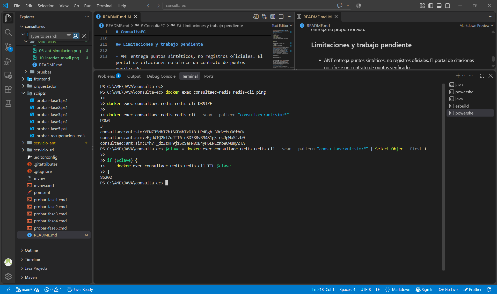


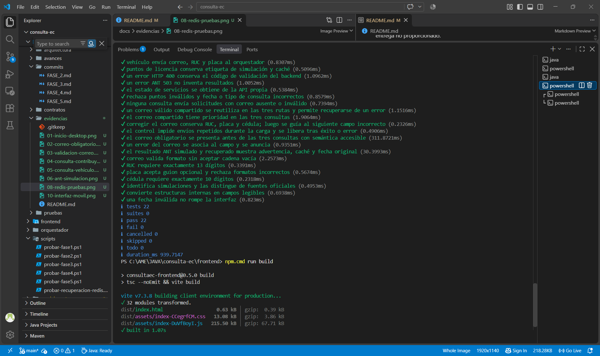


## Galería y entrega de evidencias

Las once imágenes están organizadas junto a la función que ilustran en este README. Su [guía de captura](docs/evidencias/README.md) especifica el proceso, la acción y los datos que deben ocultarse. Guardar cada archivo auténtico en `docs/evidencias/` con el nombre indicado y confirmarlo en Git para que GitHub lo muestre. Adjuntar las salidas de pruebas y el registro de usabilidad que efectivamente se obtengan, conforme a las indicaciones de la asignatura; no se presupone un formato de entrega no proporcionado.

## Limitaciones y trabajo pendiente

- ANT entrega puntos sintéticos, no registros oficiales. El portal de citaciones no ofrece un contrato de puntos verificado.
- Las tres rutas SRI están implementadas y probadas con HTTP simulado; faltan verificaciones en vivo con datos propios o autorizados.
- Redis funciona localmente en Docker y actúa como caché temporal, sin historial permanente ni Redis Cloud implementado.
- Falta colocar el enlace y la captura del modelo IcePanel **de la autora**, además de actualizar sus vistas C1/C2/C3 si aún reflejan otra infraestructura.
- El hallazgo cualitativo de correo ya se atendió; la validación humana posterior, sus tiempos y resultados cuantitativos siguen pendientes.
